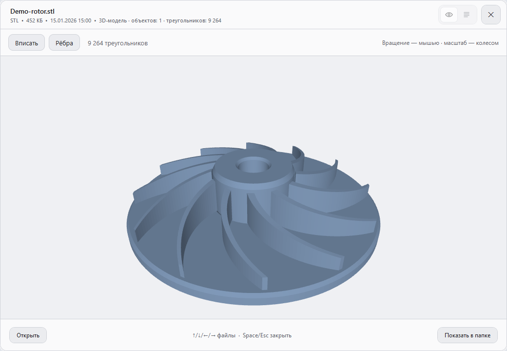
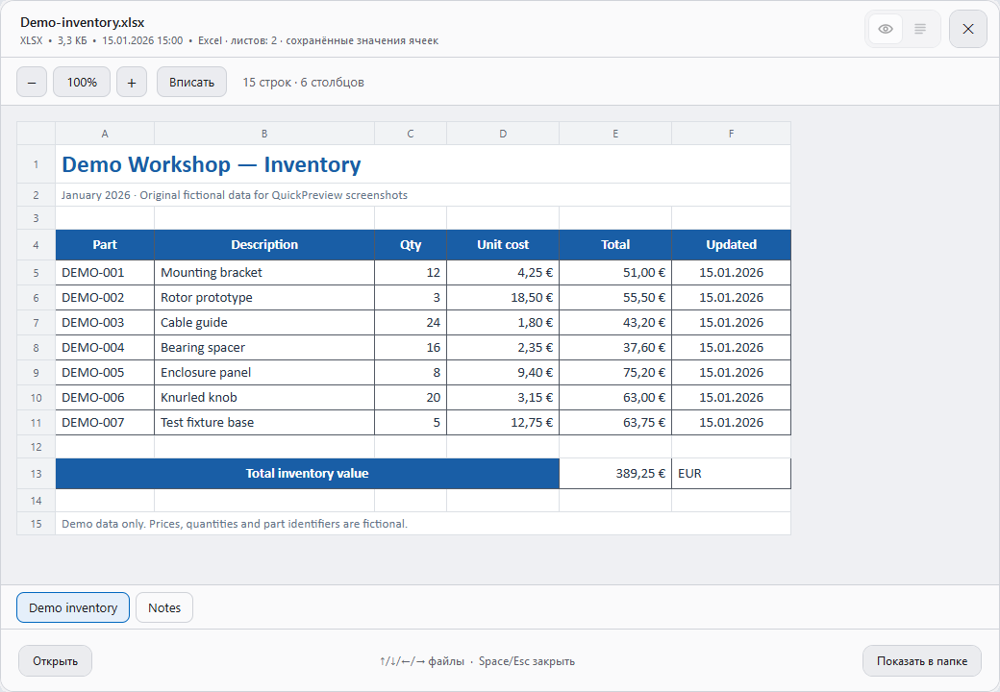
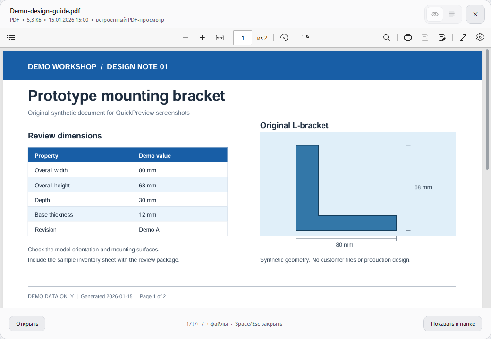
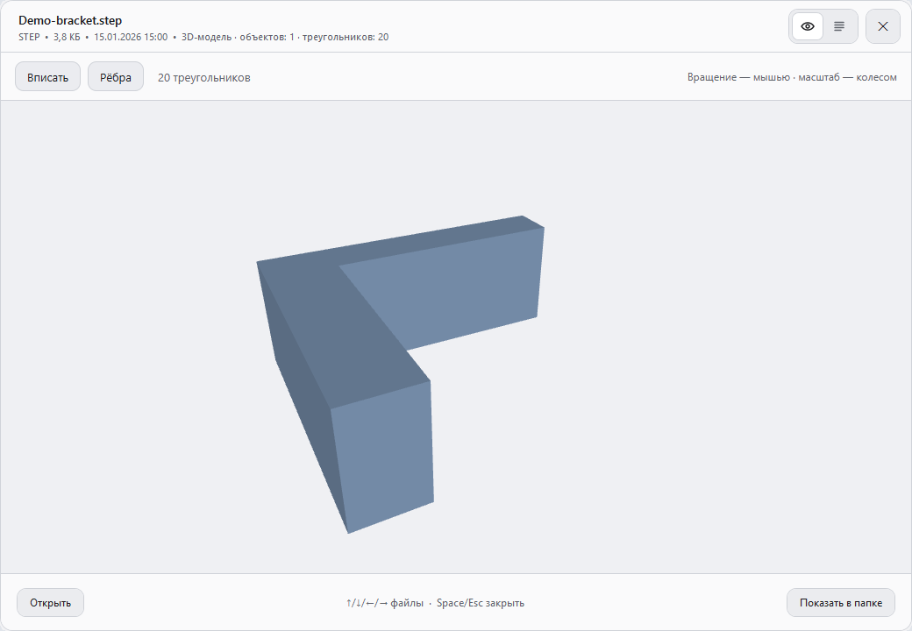
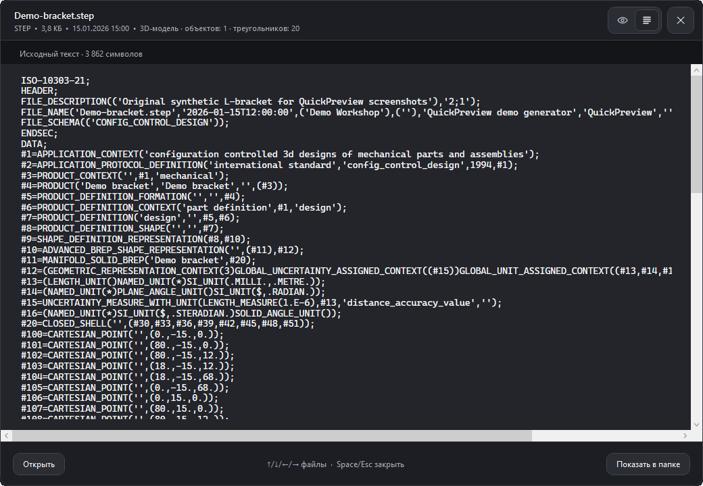
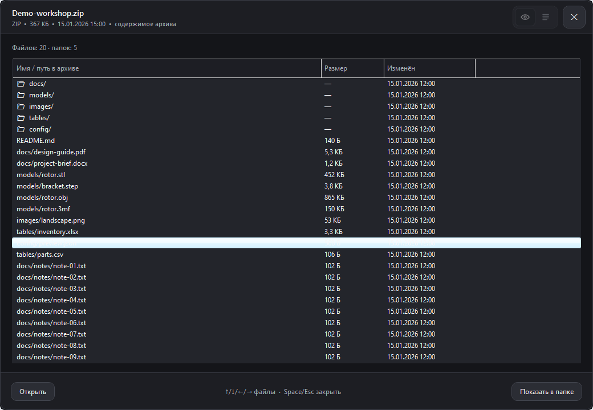
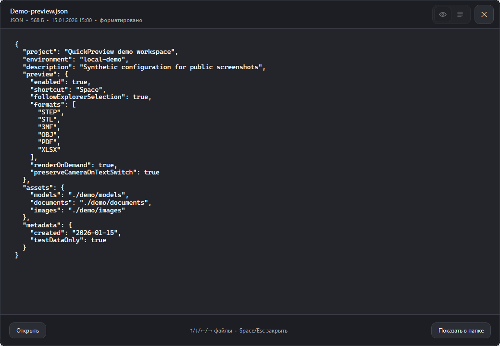
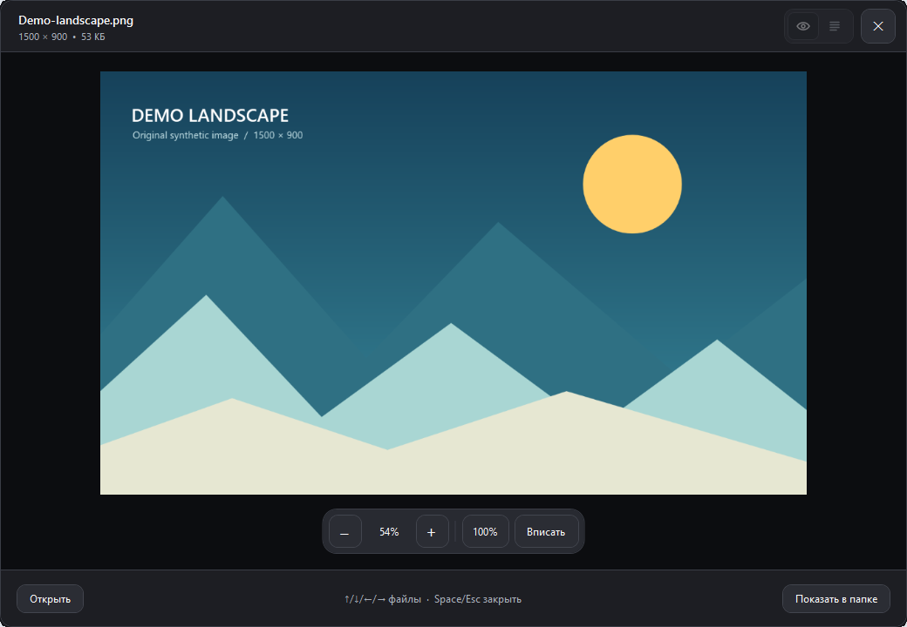
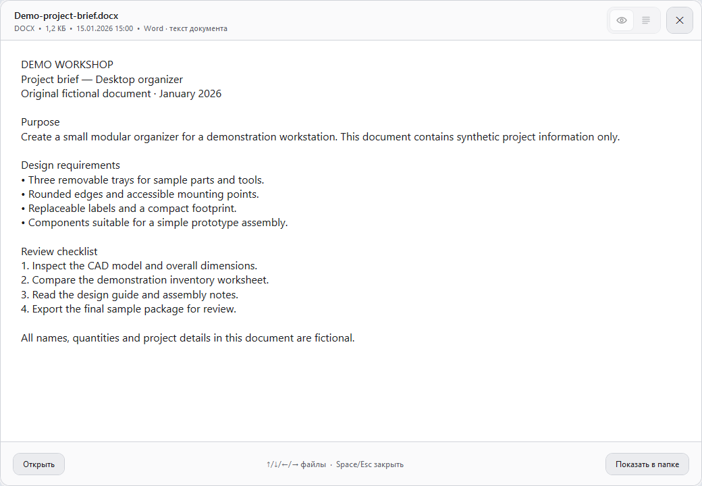

# QuickPreview for Windows

### Quick Look-style file preview for Windows — select a file in File Explorer and press <kbd>Space</kbd>

[](https://github.com/kavabunga6/QuickPreview-Windows/releases/latest)
[](https://github.com/kavabunga6/QuickPreview-Windows/releases/latest)
[](LICENSE)

QuickPreview is a lightweight, open-source file previewer for Windows Explorer. It brings the familiar macOS Quick Look workflow to Windows: highlight a file, press <kbd>Space</kbd>, and instantly preview images, videos, music, text, source code, folders, and other formats supported by Windows.

**[Download QuickPreview for Windows](https://github.com/kavabunga6/QuickPreview-Windows/releases/latest/download/QuickPreview-Setup.exe)**

<p align="center">
  <a href="assets/screenshots/3d-model.png"></a>
</p>

## Features

- Switch between **Visual** and **Text** using the persistent icon switcher beside Close, preserving the loaded model and camera. The switcher stays disabled for files with only one representation.
- Rotate and zoom STEP/STL/3MF/OBJ and other CAD/3D models locally, with bundled STEP/IGES/BREP tessellation.
- Inspect DWG/DXF model-space drawings, SVG, design/RAW images, local font files, CSV tables, emails and EPUB books.
- Inspect SQLite tables, EVTX events, PCAP packets, ISO directory entries, PE binaries and certificate metadata without executing files.
- Open or close a file preview with <kbd>Space</kbd> in Windows File Explorer.
- Follow the actual File Explorer selection with arrow keys, using Explorer's current sort, grouping, and icon layout.
- Keep preview and Explorer selection synchronized, including when the preview window has focus.
- Preview images at their original resolution within resource limits, reducing large images while fitting the window to the screen.
- Zoom images from 5% to 800% with the mouse wheel, keyboard, or on-screen controls.
- Pan around a zoomed image by dragging it with the left mouse button.
- Respect EXIF Orientation, so portrait photos stay portrait.
- Play audio and video with seeking, volume control, mute, and media controls.
- Show embedded MP3, M4A, and FLAC artwork through the Windows thumbnail provider.
- Preview text, Markdown, YAML, CSV, logs, and popular source-code formats.
- Pretty-print valid JSON and XML while keeping malformed documents available as raw text.
- Read PDF documents interactively with page navigation, scrolling, zoom, search, and printing.
- List ZIP, 7z, RAR, TAR, and compressed TAR contents without extracting files, including paths, sizes, and modification times.
- View Excel and OpenDocument spreadsheets as tables with merged cells, column widths, basic formatting, worksheet selection and zoom.
- Read Word documents and PowerPoint slide text locally, including OpenDocument files.
- Show folder contents and Windows-generated thumbnails for other known file types.
- Follow the Windows light/dark theme and system accent color automatically.
- Run quietly in the system tray with optional startup at Windows sign-in.
- Install per user without administrator privileges.

## Screenshots

All screenshots use generated demo files with fictional content. Click an image to view it at full size.
The [screenshot generator](tests/GithubScreenshots/README.md) recreates the files and captures the actual application window.

<table>
  <tr>
    <th>Excel worksheet</th>
    <th>PDF document</th>
  </tr>
  <tr>
    <td><a href="assets/screenshots/spreadsheet.png"></a></td>
    <td><a href="assets/screenshots/pdf.png"></a></td>
  </tr>
  <tr>
    <th>STEP model</th>
    <th>STEP source text</th>
  </tr>
  <tr>
    <td><a href="assets/screenshots/step-model.png"></a></td>
    <td><a href="assets/screenshots/step-source.png"></a></td>
  </tr>
  <tr>
    <th>ZIP archive</th>
    <th>JSON source code</th>
  </tr>
  <tr>
    <td><a href="assets/screenshots/archive.png"></a></td>
    <td><a href="assets/screenshots/source-code.png"></a></td>
  </tr>
  <tr>
    <th>PNG image</th>
    <th>Word document</th>
  </tr>
  <tr>
    <td><a href="assets/screenshots/image.png"></a></td>
    <td><a href="assets/screenshots/word.png"></a></td>
  </tr>
</table>

## Keyboard shortcuts

| Shortcut | Action |
| --- | --- |
| <kbd>Space</kbd> | Open or close preview |
| <kbd>↑</kbd> / <kbd>↓</kbd> / <kbd>←</kbd> / <kbd>→</kbd> | Follow Explorer selection; previous/next item when the preview has focus |
| <kbd>Esc</kbd> | Close preview |
| <kbd>Enter</kbd> | Open the current file |
| <kbd>+</kbd> / <kbd>−</kbd> | Zoom an image in or out |
| <kbd>Ctrl</kbd>+<kbd>0</kbd> | Fit an image to the preview window |
| <kbd>Ctrl</kbd>+<kbd>Shift</kbd>+<kbd>E</kbd> | Show the current file in Explorer |

## Installation

1. Download **QuickPreview-Setup.exe** from the [latest release](https://github.com/kavabunga6/QuickPreview-Windows/releases/latest).
2. Run the installer. Administrator rights are not required.
3. Select a file in File Explorer and press <kbd>Space</kbd>.

The installer adds QuickPreview to the Start menu and Windows Installed Apps. It also includes a standard uninstaller. The release is self-contained, so a separate .NET installation is not required.

### What is new in 1.3.10

Image decoding, folder thumbnails and folder reads now run away from the UI with bounded resources. Large photos are reduced explicitly, EXIF orientation is preserved, and deeply nested XML is rejected safely. Excel previews correctly display scaled units, custom zero formats, dates and elapsed times without recalculating formulas. See the [changelog](CHANGELOG.md) and [supported formats and limitations](SUPPORTED_FORMATS.md).

## Settings and startup

Double-click the QuickPreview tray icon, or right-click it and choose **Settings**. The settings window includes an option to launch QuickPreview automatically when you sign in to Windows. The interface follows the active Windows theme.

## Build from source

Requirements:

- Windows 10 or 11, x64
- [.NET 6 SDK](https://dotnet.microsoft.com/download/dotnet/6.0)
- [Inno Setup 6](https://jrsoftware.org/isinfo.php) for building the installer

```powershell
dotnet build -c Release
powershell.exe -NoProfile -ExecutionPolicy Bypass -File .\installer\build-installer.ps1
```

The self-contained installer is written to `artifacts\QuickPreview-Setup.exe`.

## Notes

- Available video formats depend on media codecs installed in Windows.
- Interactive PDF preview uses the Microsoft Edge WebView2 Runtime. If it is unavailable, the Windows PDF renderer displays pages with previous/next page controls.
- Office content preview supports DOCX/XLSX/PPTX and their macro/template variants, plus ODT/ODS/ODP. Spreadsheets retain basic cell formatting and merged ranges; Word and PowerPoint show readable text. Original page layouts, images and charts require opening the document. Macros, formulas and external links are never executed.
- Legacy DOC/PPT content uses installed Windows Office search filters. Legacy XLS cells are read locally with simplified formatting. Protected files require opening in an office application.
- Spreadsheet number formats include scaled units, custom zero sections, percentages, dates and elapsed times. Unsupported or invalid formats fall back to the saved value.
- Archive listings are limited to 1,000 entries and a bounded reading time. Archives with encrypted filenames need to be opened in an archive application to enter a password.
- 3D preview uses locally bundled browser/WASM libraries and the installed WebView2 Runtime; no CAD application or runtime Node.js installation is required. DWG/DXF show supported 2D model-space entities rather than complete AutoCAD layouts/solids.
- Image, Windows thumbnail and drawing decoding runs in a separate process with memory/time limits. Ordinary raster images accept up to 64 megapixels and 32,768 pixels per side; the displayed bitmap is limited to 16 megapixels and 16,384 pixels per side. A status message identifies reduced previews. Very large or unsupported files can still be opened with the normal **Open** action.
- Folder previews scan at most 4,096 entries within a time budget and show up to 24 sorted entries. Slow or unavailable filesystem reads do not block the UI.
- XML parsing forbids DTDs and nesting beyond 128 levels. Plain XML remains readable as raw text when formatting fails; documents that require unsafe XML are refused.
- Third-party license texts and 3D module provenance ship with the installation.
- The global <kbd>Space</kbd> shortcut currently targets File Explorer windows.

## Русский

QuickPreview — открытый просмотрщик файлов для Windows в стиле Quick Look на macOS. Выделите файл в Проводнике и нажмите <kbd>Space</kbd>: приложение покажет фото, видео, музыку, текст, PDF, содержимое архивов, документы Office и содержимое папок. Стрелки переключают выделение в текущем порядке Проводника, а предпросмотр следует за ним.

Настройки открываются двойным щелчком по значку в трее. Там можно включить запуск вместе с Windows. Установщик работает без прав администратора, добавляет ярлык в меню «Пуск» и штатное удаление через список установленных приложений.

## License

QuickPreview is released under the [MIT License](LICENSE).
